# My Calendar

A phone-friendly calendar app by **[AKIBUZZAMAN AKIB](https://github.com/AKIBUZZAMAN-AKIB)** (@AKIBUZZAMAN-AKIB). Five views, Subjects you can rename, delete and merge, a floating time picker that sets any exact minute, complete event boxes like Google Calendar, and events saved on your device. It also ships as **one offline HTML file**.

<p align="center">
  <a href="https://akibuzzaman-akib.github.io/my-calendar/"><b>Open the live app</b></a> ·
  <a href="#demo-videos"><b>Demo videos</b></a> ·
  <a href="docs/GUIDE.md"><b>User guide</b></a> ·
  <a href="release/calendar.html"><b>Download the single HTML file</b></a>
</p>

## Demo videos

Two slow, smooth **60fps** walkthroughs of every feature, recorded from the real app (no voice, no music). Tap a preview to open the MP4 file on GitHub, then use **View raw** or the download button to watch it.

<table>
  <tr>
    <th>Desktop · 5:27 · 1920×1080 · 60fps</th>
    <th>Phone · 2:48 · 1080×1920 · 60fps</th>
  </tr>
  <tr>
    <td align="center" valign="top">
      <a href="docs/video/demo-desktop-1920x1080-60fps.mp4">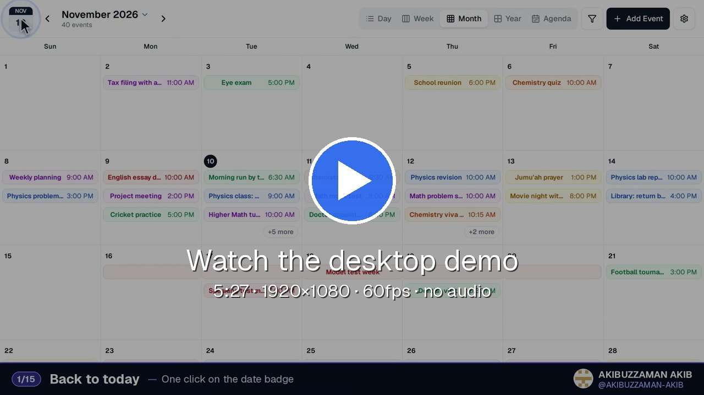</a>
      <br><br>
      <a href="docs/video/demo-desktop-1920x1080-60fps.mp4">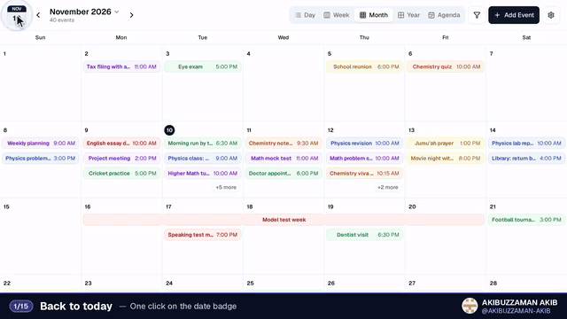</a>
    </td>
    <td align="center" valign="top">
      <a href="docs/video/demo-phone-1080x1920-60fps.mp4">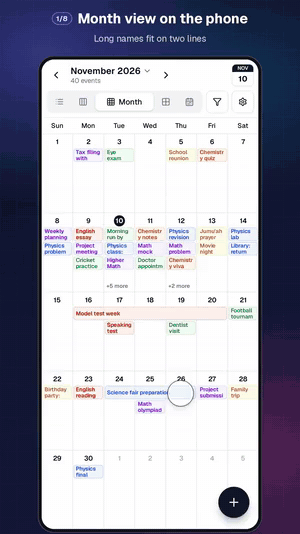</a>
    </td>
  </tr>
  <tr>
    <td align="center">
      <a href="docs/video/demo-desktop-1920x1080-60fps.mp4"><b>▶ Desktop demo</b></a> · MP4, 22.8 MB
    </td>
    <td align="center">
      <a href="docs/video/demo-phone-1080x1920-60fps.mp4"><b>▶ Phone demo</b></a> · MP4, 13.7 MB
    </td>
  </tr>
</table>

**Desktop demo chapters:** Month view (0:04) · switching views (0:34) · Week view (0:48) · creating an event with the floating time picker (1:10) · editing the time (2:01) · drag and drop in Week and Day (2:25) and Month (2:47) · resizing (2:58) · deleting (3:09) · filtering (3:17) · Subjects: rename, delete, merge (3:38) · Year (4:20) · Agenda and search (4:31) · Settings and dark mode (4:48) · saved after reload (5:08).

**Phone demo chapters:** two-line Month view (0:04) · switching views (0:13) · swiping Week up, down and sideways (0:35) · Day view with events side by side (0:49) · press and hold to move (1:03) · creating with + and the time picker (1:18) · editing the time to 8:33 PM (1:50) · renaming and merging Subjects, dark mode (2:13).

<details>
<summary>Older 60-second promo video</summary>

The first short promo with feature cards (60 seconds, before the 60fps demos): [1920×1080](docs/video/promo-1920x1080.mp4) · [vertical 1080×1920](docs/video/promo-vertical-1080x1920.mp4)

[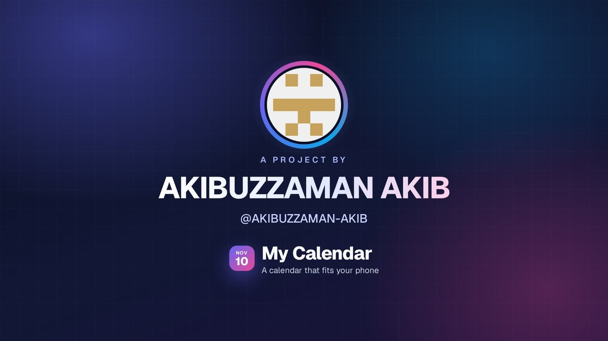](docs/video/promo-1920x1080.mp4)

</details>

## Features

- **Five views:** Day, Week, Month, Year and Agenda. Switching is fast: the tab lights up the moment you tap it and the view follows right after.
- **More text in Month view:** in five-row months every chip shows two lines of its title, and "…" appears only when the second line is really full. Six-row months show one line that fades out at the edge, like Google Calendar. Multi-day bars use their full width for the title and repeat it on each week row. "+N more" opens the rest of a busy day.
- **Complete event boxes in Week and Day:** overlapping events share columns like Google Calendar. No box spills out of its column or the screen; titles use as many lines as fit, then "…". Very short events stay at least 20 minutes tall. Multi-day bars end inside their row and show ‹ › arrows when they continue outside the week.
- **Week and Day scroll sideways on phones:** each day is at least 84px wide, and Day view widens when many events overlap. Day names and the hour column stay pinned, and the title of a multi-day bar stays on screen while you scroll.
- **Floating time picker:** a small panel next to the field, shared by Create and Edit. Tap an hour, a 5-minute step, then any single minute, so every minute is two taps away. −/+ change one minute at a time (hold to go faster). 12-hour mode has AM/PM. The panel opens above the field when there is no room below and never pops up the keyboard.
- **Editing the time works like creating:** Edit uses the same picker as Create, so times such as 10:02 show and change correctly. Changing the start keeps the event's length.
- **Floating date picker:** the calendar opens in its own small panel that fits a 360px screen.
- **Subjects:** every event has a Subject (Study, Work, Personal, Health, or your own). Filter by Subject, and **rename, delete or merge** Subjects; their events follow along. Deleting asks where the events go: another Subject or "No subject". The pickers are the app's own, with the Subject colour and event count on every row.
- **Tap an empty slot** in Week or Day view to create an event at that time.
- **Drag and drop:** with the mouse on desktop, or press and hold on a phone. Resize by dragging a box edge with the mouse; on a phone, change the length with Edit.
- **Saved on your device:** events, Subjects and settings live in `localStorage` and survive a reload. No account and no server.
- **Settings:** dark mode, chip or dot event style, 12/24-hour time, the hour the day starts at, Agenda grouping, and removing the sample events.
- **Single HTML build:** `npm run build:single` makes one ~870 KB file with the code, styles and Geist font inside. It works offline with no network requests.

## Screenshots

Real screenshots from Chromium. Every screen is available for Android (360×740), iPhone (390×844) and desktop (1440×900) in [`docs/screenshots`](docs/screenshots).

| Month | Week | Busy day | Time picker |
| --- | --- | --- | --- |
| 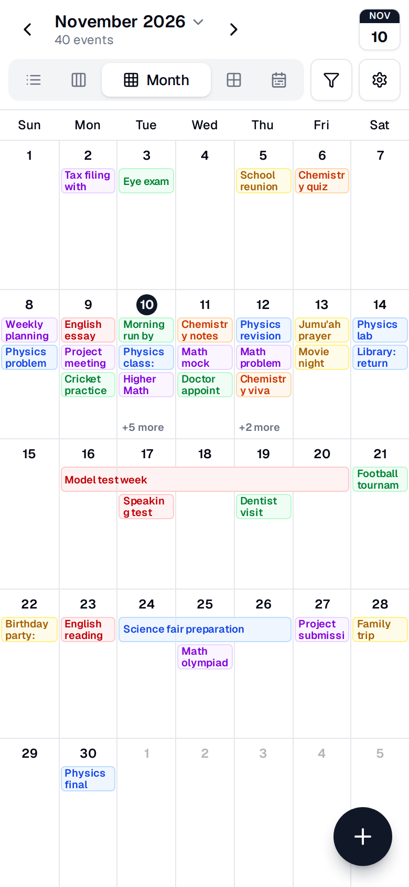 | 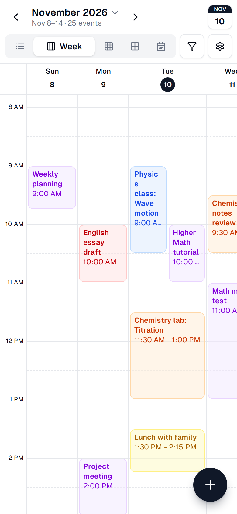 | 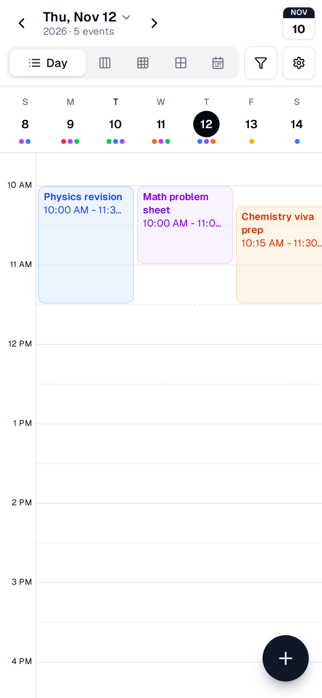 | 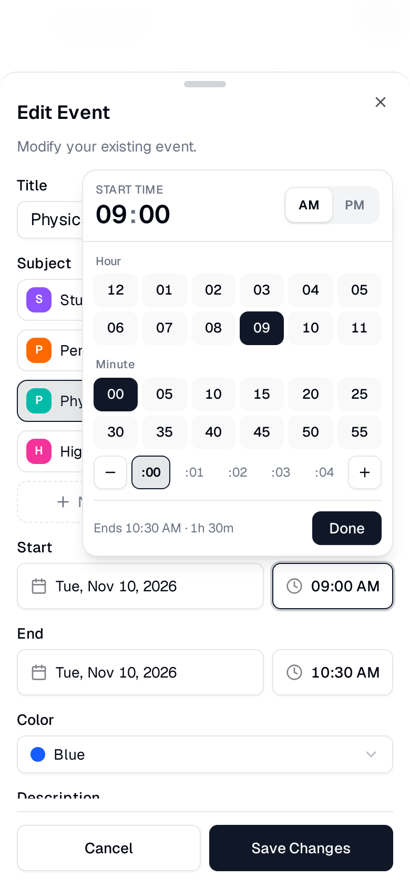 |

| Exact minute | Date picker | Edit event | Week swiped sideways |
| --- | --- | --- | --- |
| 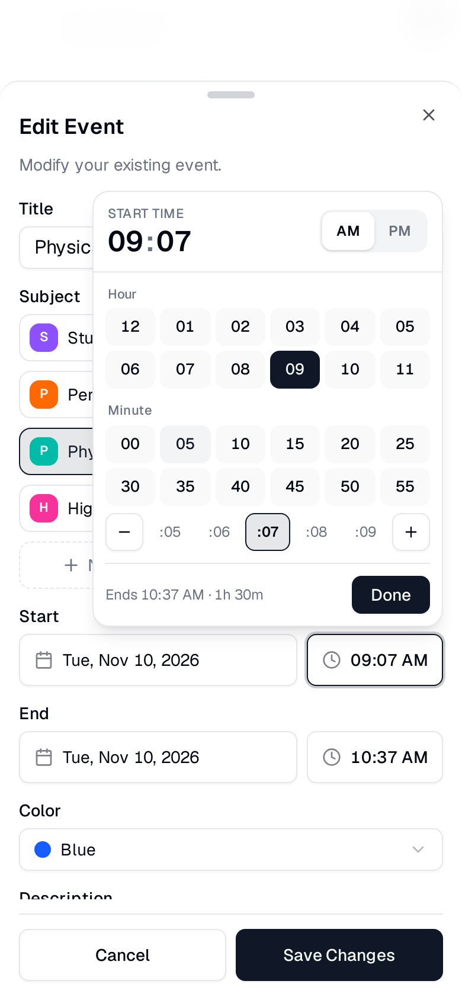 | 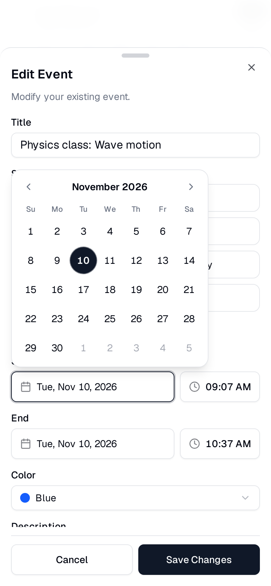 | 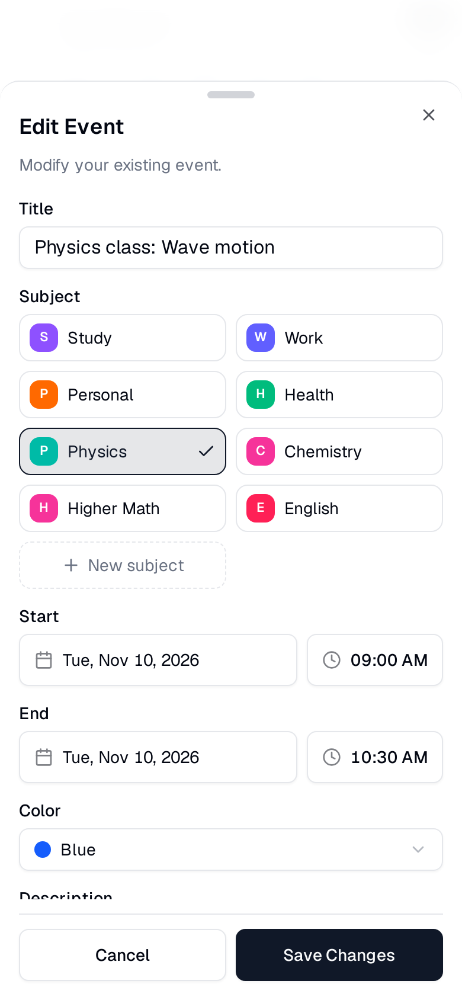 | 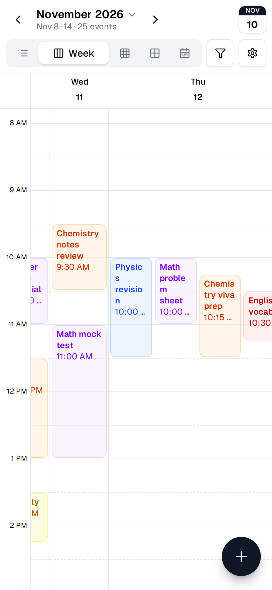 |

| Manage Subjects | Merge Subjects | Settings | Dark mode |
| --- | --- | --- | --- |
| 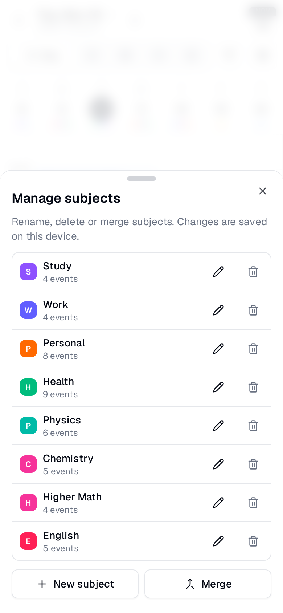 | 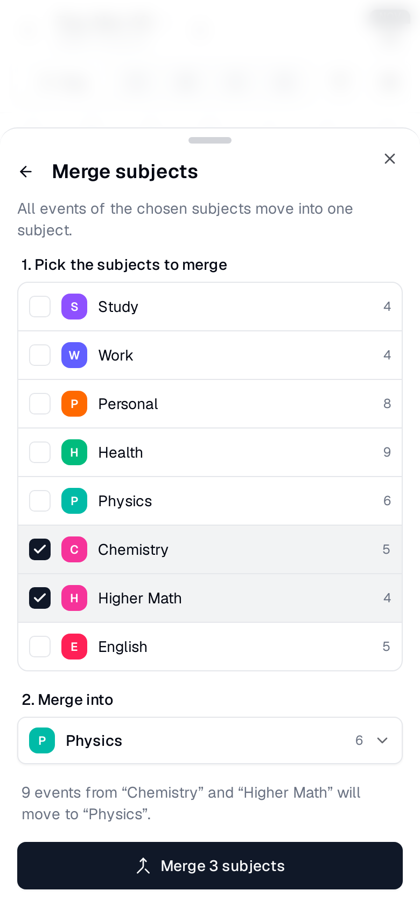 | 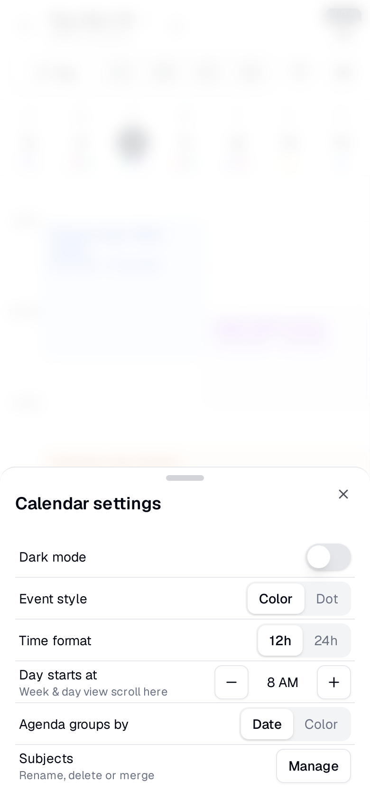 | 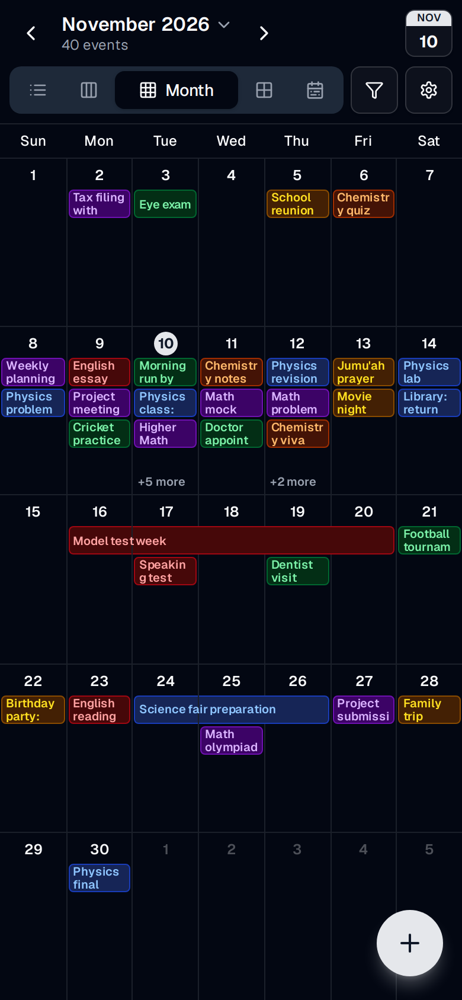 |

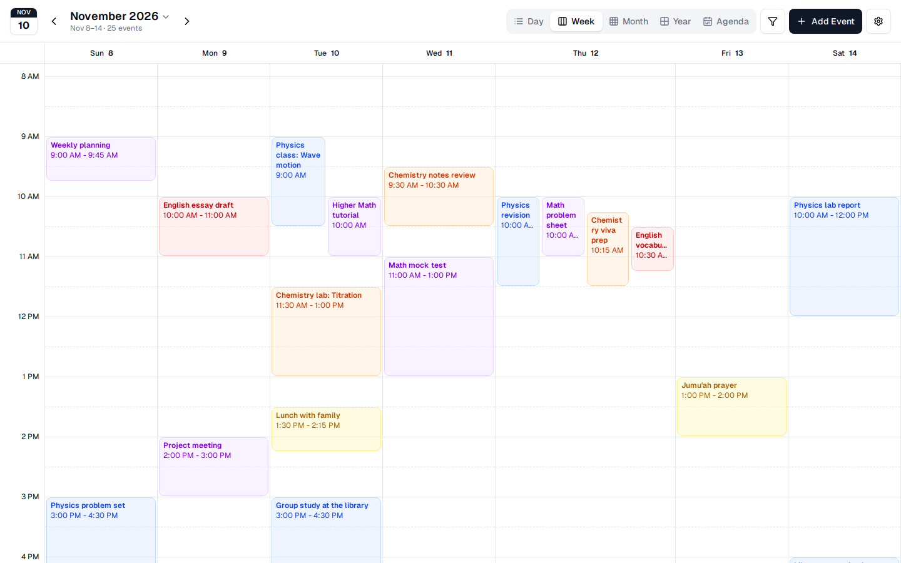

## Screen recordings

Short MP4 recordings of real interactions, in [`docs/recordings`](docs/recordings). A blue circle shows where the finger taps.

| Recording | What it shows |
| --- | --- |
| [create-event.mp4](docs/recordings/create-event.mp4) | Creating "Chemistry practical exam" with a Subject, colour and the time picker |
| [edit-time.mp4](docs/recordings/edit-time.mp4) | Editing an event's time to 8:33 PM with the picker and the + button |
| [switch-views.mp4](docs/recordings/switch-views.mp4) | Month → Week → Day → Year → Agenda → Month |
| [week-day-scroll.mp4](docs/recordings/week-day-scroll.mp4) | Swiping Week and a busy Day sideways |
| [manage-subjects.mp4](docs/recordings/manage-subjects.mp4) | Renaming, merging and deleting Subjects |
| [persist-reload.mp4](docs/recordings/persist-reload.mp4) | Tapping an empty slot, saving, reloading: the event is still there |
| [desktop-tour.mp4](docs/recordings/desktop-tour.mp4) | Drag and drop, Day view, dark mode and Agenda on desktop |

<p>
  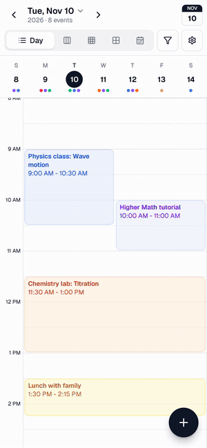
  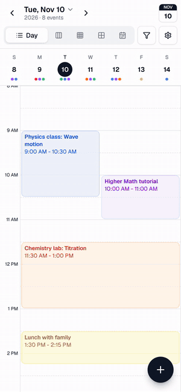
  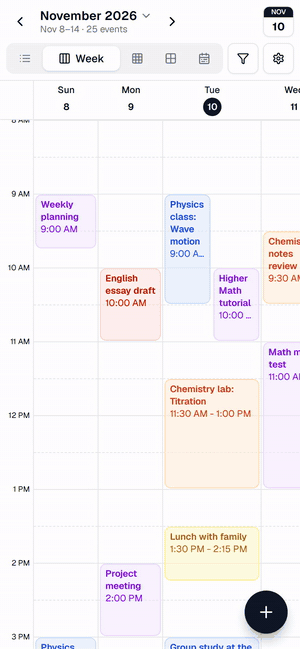
  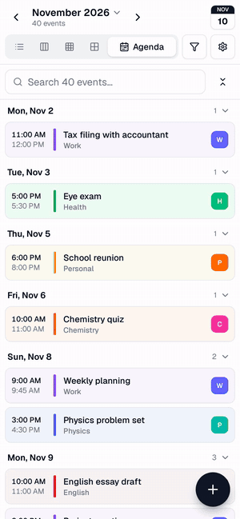
</p>

## Quick start

### Use it online

Open **[akibuzzaman-akib.github.io/my-calendar](https://akibuzzaman-akib.github.io/my-calendar/)** on your phone or computer. GitHub Pages serves only the app there: the same single HTML file as [`release/calendar.html`](release/calendar.html). Events are saved in that browser.

### Use it offline

Download [`release/calendar.html`](release/calendar.html) (open it on GitHub and use **Download raw file**) and open it in any modern browser. On a phone, if a file viewer does not keep your events, use the online link above instead.

### Run from source

```bash
git clone https://github.com/AKIBUZZAMAN-AKIB/my-calendar.git
cd my-calendar
pnpm install
pnpm dev
```

Open `http://localhost:3000/calendar`.

| Command | What it does |
| --- | --- |
| `pnpm dev` | Development server |
| `pnpm build` / `pnpm start` | Production build and server |
| `npm run build:single` | Builds `dist/single.html`, the one-file offline calendar |

## Documentation

- [User guide](docs/GUIDE.md): every feature step by step, with screenshots, plus how the single-file build works.
- [Screenshots](docs/screenshots) · [Screen recordings](docs/recordings) · [Videos](docs/video)

## Tech stack

Next.js, React, TypeScript, Tailwind CSS, shadcn/ui, date-fns, React Hook Form with Zod. The single-file build uses esbuild, the Tailwind CLI and html-minifier-terser ([`scripts/build-single.mjs`](scripts/build-single.mjs)).

## Project layout

```
src/features/calendar/   calendar views, dialogs, Subjects, drag and drop, settings
src/components/ui/       shared UI, including the floating date-time picker
single/                  entry point and HTML template for the single-file build
scripts/build-single.mjs single-file build script
release/calendar.html    ready-made single-file build
docs/                    guide, screenshots, recordings and videos
```

GitHub Pages is served from the separate `gh-pages` branch, which holds only the app (`index.html`, a copy of `release/calendar.html`). To update the live app, copy the new build there as `index.html` and push that branch.

## Author

**AKIBUZZAMAN AKIB** · [@AKIBUZZAMAN-AKIB](https://github.com/AKIBUZZAMAN-AKIB)

## Credits and license

This project is built on [Full Calendar](https://github.com/yassir-jeraidi/full-calendar) by Jeraidi Yassir, released under the MIT License. The original copyright notice is kept in [LICENSE](LICENSE). The documentation pages under `content/docs` describe the original component.
