# My Calendar user guide

This guide walks through every feature of **My Calendar** by [AKIBUZZAMAN AKIB](https://github.com/AKIBUZZAMAN-AKIB), step by step, with real screenshots from the app. It also shows how to use the app offline as one HTML file and how to build that file yourself.

The screenshots were taken in Chromium on an iPhone-sized screen (390 × 844) unless a caption says otherwise. Android (360 × 740) and desktop (1440 × 900) versions of every screenshot are in [`screenshots/android`](screenshots/android) and [`screenshots/desktop`](screenshots/desktop). Short screen recordings of each flow are in [`recordings`](recordings).

## Contents

1. [Open the calendar](#1-open-the-calendar)
2. [The five views](#2-the-five-views)
3. [Create an event](#3-create-an-event)
4. [The floating time and date picker](#4-the-floating-time-and-date-picker)
5. [View, edit and delete an event](#5-view-edit-and-delete-an-event)
6. [Move events with drag and drop](#6-move-events-with-drag-and-drop)
7. [Scroll Week and Day sideways](#7-scroll-week-and-day-sideways)
8. [Subjects: filter, rename, delete and merge](#8-subjects-filter-rename-delete-and-merge)
9. [Settings and dark mode](#9-settings-and-dark-mode)
10. [Where your events are saved](#10-where-your-events-are-saved)
11. [Use the single HTML file offline](#11-use-the-single-html-file-offline)
12. [Build the single HTML file](#12-build-the-single-html-file)
13. [Run the project from source](#13-run-the-project-from-source)

## 1. Open the calendar

There are two ways to open it:

- **The single file:** download [`release/calendar.html`](../release/calendar.html) and open it in a browser. Everything (code, styles and the Geist font) is inside that one file, so it needs no server and no internet.
- **From source:** run the Next.js app (see [section 13](#13-run-the-project-from-source)) and open `http://localhost:3000/calendar`.

On the first visit the calendar starts with a few sample events, so the views are not empty. You can remove them later in Settings; your own events are kept.

## 2. The five views

The view tabs in the header switch between **Day**, **Week**, **Month**, **Year** and **Agenda**. The tab lights up the moment you tap it, and the view follows right after. Use the arrows to move back and forward, and **Today** to jump back to the current date.

| Month | Week | Day |
| --- | --- | --- |
| 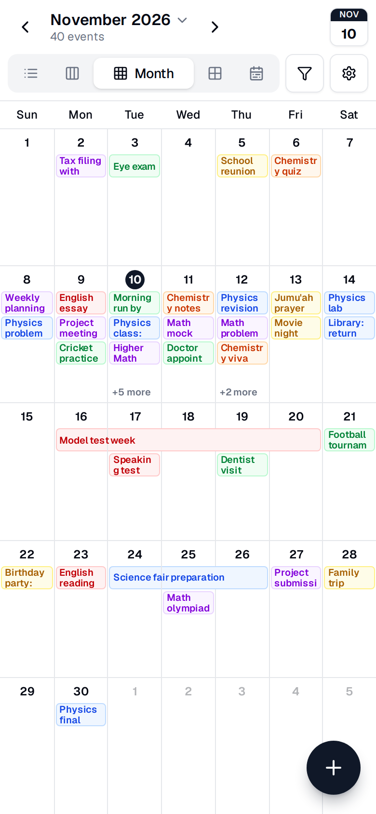 | 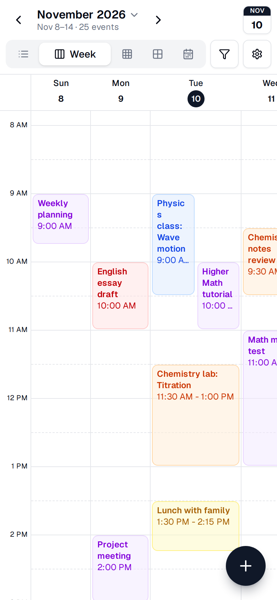 | 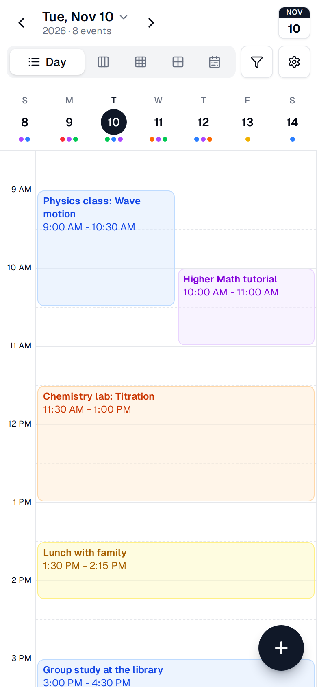 |

| Year | Agenda |
| --- | --- |
| 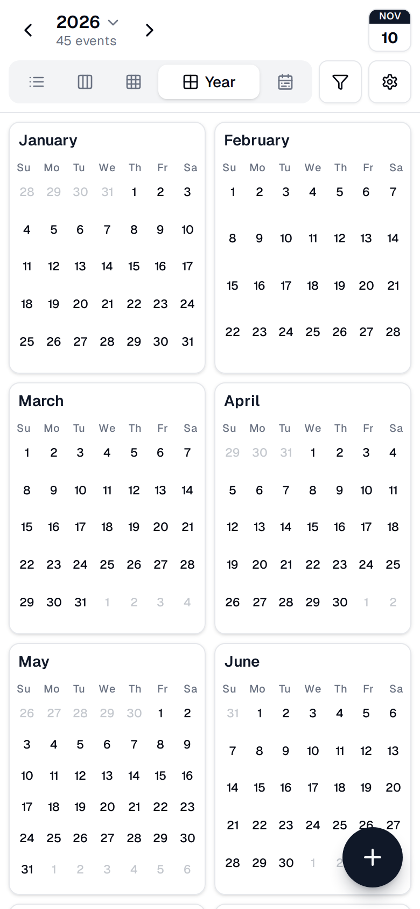 | 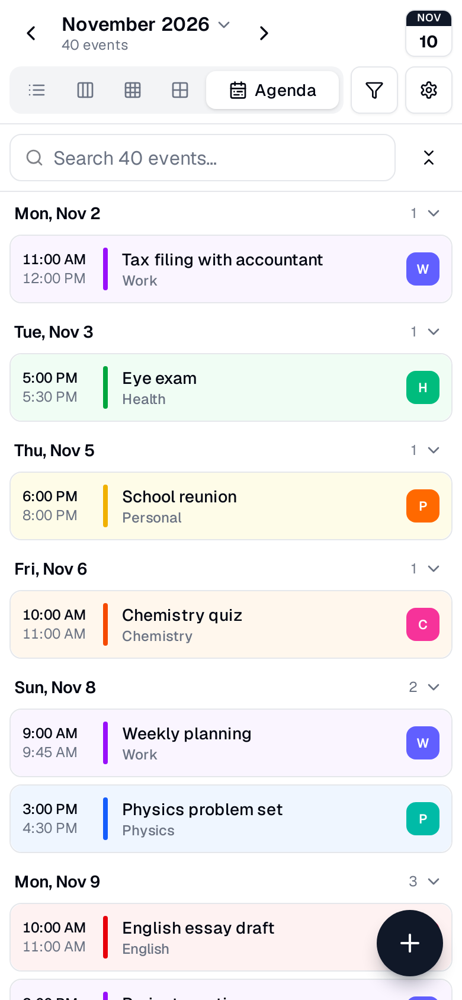 |

- **Month:** each event is a coloured chip. In months with five rows a chip shows two lines of its title; in six-row months it shows one line that fades out at the edge. Events that last several days are drawn as one bar across the days, with the full title. When a day has more events than fit, tap **+N more** to see them all.
- **Week and Day:** a time grid. The row of day names stays at the top and the hour column stays on the left while you scroll. Tap a day name in Week view to open that day. Overlapping events share the width in columns, like Google Calendar, and every box stays inside its own column.
- **Year:** all twelve months at once. Tap a month name to open it in Month view.
- **Agenda:** a list of upcoming events with a search box. In Settings you can group it by date or by colour.

Recording: [`recordings/switch-views.mp4`](recordings/switch-views.mp4)

## 3. Create an event

1. Tap the round **+** button (bottom right on phones) or **Add Event** in the header on desktop. You can also tap an empty slot in Week or Day view: the form opens with that day and time already filled in.
2. Type a **Title**.
3. Pick a **Subject**, for example Study or Physics (see [section 8](#8-subjects-filter-rename-delete-and-merge)).
4. Set the **start** and **end** with the floating picker (next section).
5. Choose a **colour** and, if you like, add a **description**.
6. Tap the save button. The event appears in every view straight away.

| Create form | Picking the start time |
| --- | --- |
| 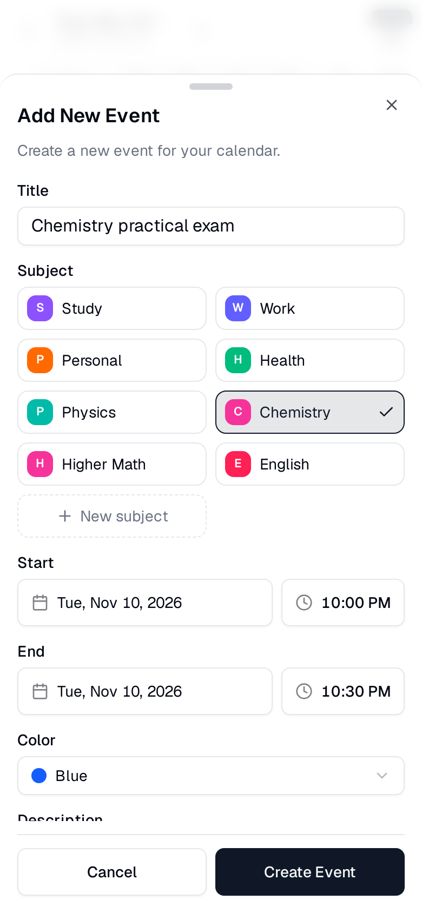 | 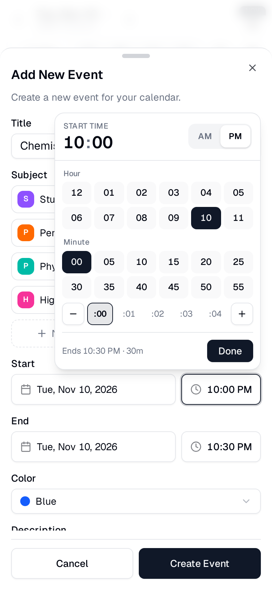 |

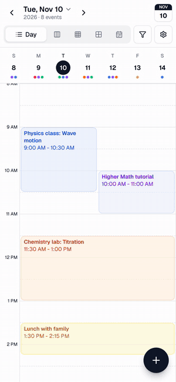

Recordings: [`recordings/create-event.mp4`](recordings/create-event.mp4) and, for tapping an empty slot, [`recordings/persist-reload.mp4`](recordings/persist-reload.mp4)

## 4. The floating time and date picker

Create and Edit use the same picker. Tap a time field and a small panel floats next to it; if there is no room below, it opens above, and it always stays at least 8px inside the screen. No text field is focused, so the phone keyboard does not pop up.

| Time panel | Any exact minute | Date panel |
| --- | --- | --- |
| 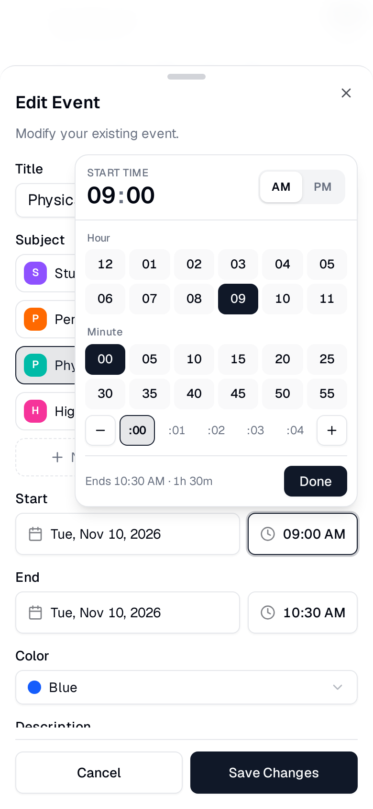 | 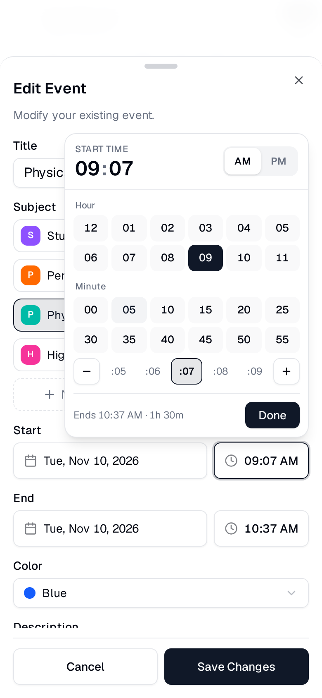 | 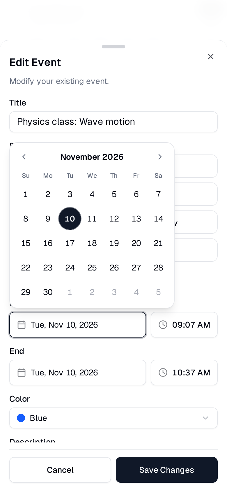 |

In the time panel:

- The chosen time is shown large at the top.
- Tap an **hour**: 24 buttons, or 12 plus **AM/PM** in 12-hour mode.
- Tap a **5-minute** button, then any single minute under it, so every minute is two taps away.
- **−** and **+** change the time by one minute; hold them to change it quickly.
- The bottom line shows when the event ends and how long it is.
- Tap **Done** or anywhere outside to close it. The panel scrolls with your finger on small screens.

Changing the start time moves the end time with it, so the length of the event stays the same. The date opens in its own small panel that fits a 360px screen.

## 5. View, edit and delete an event

Tap any event to see its details: title, time, Subject and description.

| Event details | Edit form |
| --- | --- |
| 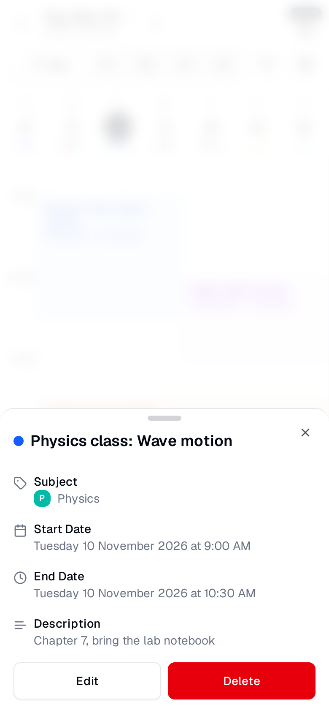 | 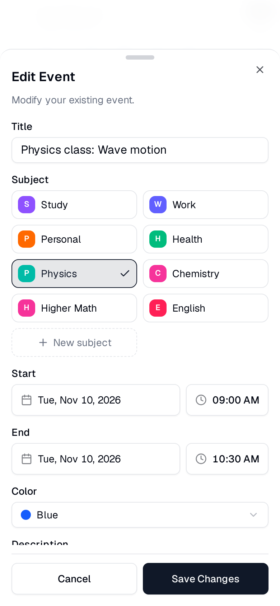 |

- **Edit** opens the same form as Create, with the same time picker. Change anything and save.
- **Delete** asks for a second tap ("Tap again to delete"), because deleting is permanent on this device.

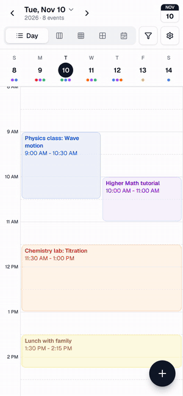

Recording: [`recordings/edit-time.mp4`](recordings/edit-time.mp4) (the event moves from 8:00 to 8:33 PM and keeps its 45-minute length)

## 6. Move events with drag and drop

- **Desktop:** drag an event with the mouse to another day or time. In Week and Day view you can also drag the edge of a box to make the event longer or shorter (mouse only).
- **Phone:** press and hold an event, then drag it to another day or time. When you drag to the edge of the screen, the grid scrolls by itself. To change the length on a phone, use Edit.

Recording: [`recordings/desktop-tour.mp4`](recordings/desktop-tour.mp4) (drags "Chemistry notes review" from Wednesday to Saturday at 1 PM)

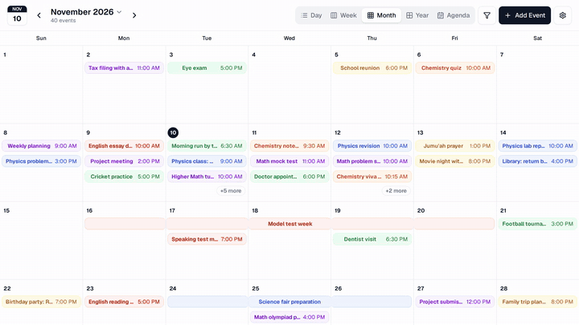

## 7. Scroll Week and Day sideways

On a phone, each day in Week view is at least 84px wide, so swipe left and right to see the whole week. Day view scrolls sideways only when many events happen at the same time, so each one keeps more than 100px. The day names and the hour column stay in place while you scroll, and up-down scrolling works as usual.

| Week, swiped sideways | A busy day | The busy day, swiped |
| --- | --- | --- |
| 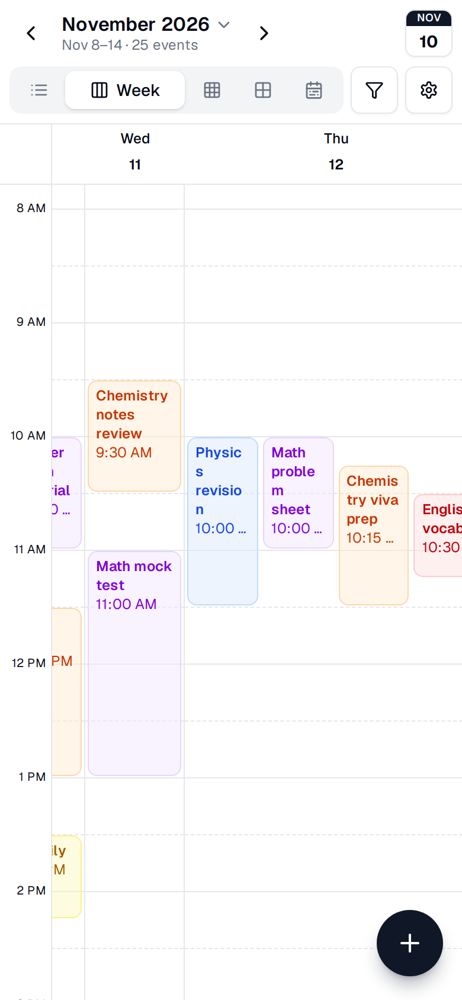 | 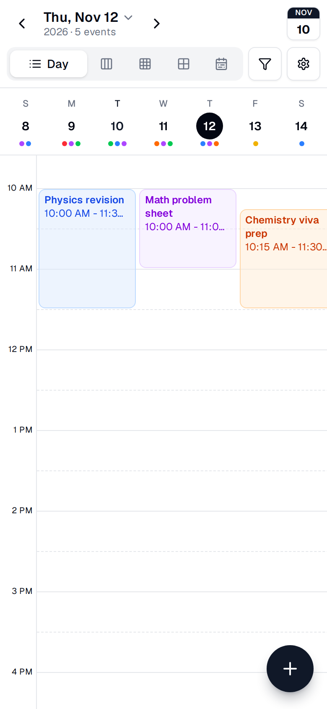 | 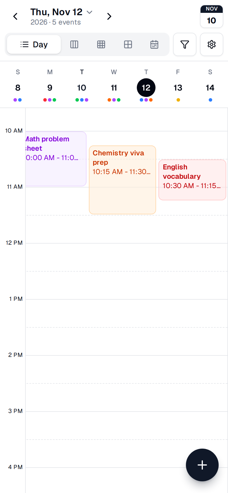 |

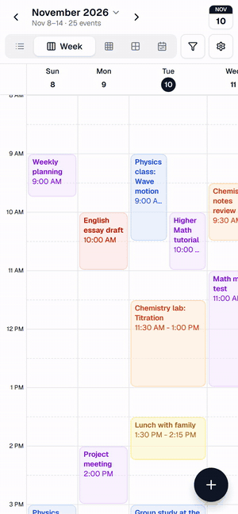

Recording: [`recordings/week-day-scroll.mp4`](recordings/week-day-scroll.mp4)

## 8. Subjects: filter, rename, delete and merge

Every event can have a **Subject**. The calendar starts with Study, Work, Personal and Health, and you can add your own from the event form.

**Filter.** Tap the filter button in the header to show only some Subjects. **No subject** finds events whose Subject was removed.

**Manage.** Tap **Edit / merge** in the filter, or **Subjects → Manage** in Settings. Both open the same screen.

| Filter | Manage Subjects | Rename |
| --- | --- | --- |
| 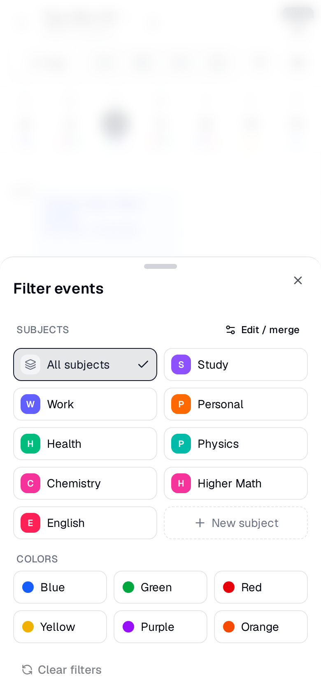 | 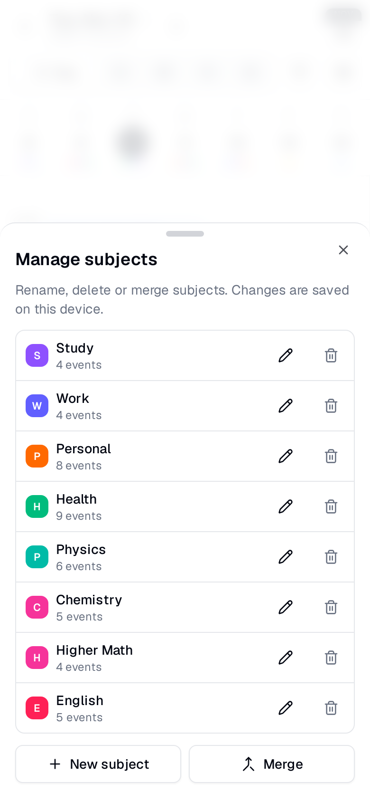 | 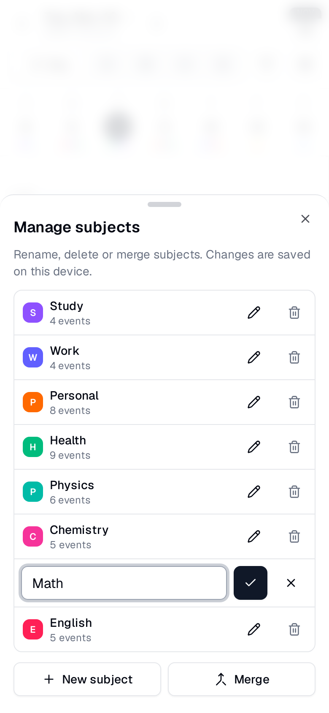 |

| Delete | Merge | Confirm merge |
| --- | --- | --- |
| 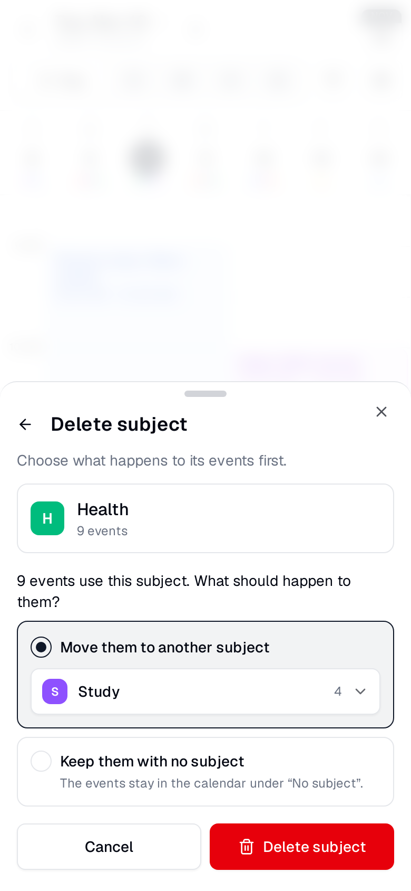 | 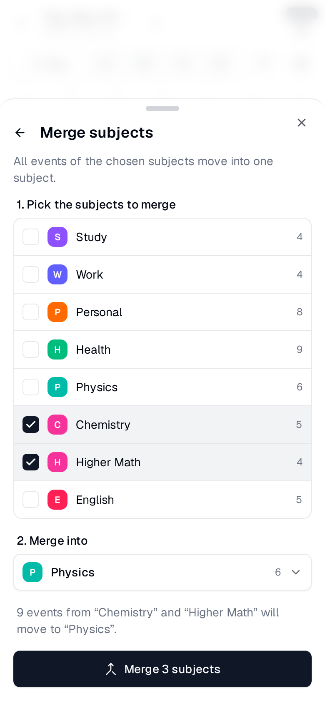 |  |

- **Rename:** any Subject, including the four starter ones. All of its events get the new name. Two Subjects cannot share a name.
- **Delete:** the app asks first. Move the events to another Subject, or keep them as "No subject".
- **Merge:** pick several Subjects and the one to merge them into. The app shows how many events will move where, then asks you to confirm.

Nothing is lost: events follow their Subject, and a backup of the old Subject list is kept on the device.

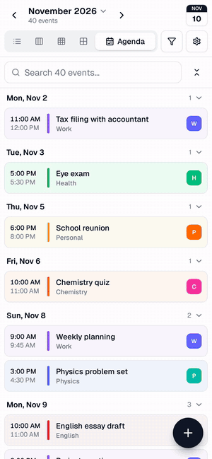

Recording: [`recordings/manage-subjects.mp4`](recordings/manage-subjects.mp4) (renames Physics to Science, merges Chemistry and Higher Math into Science, then deletes Health and moves its events to Personal)

## 9. Settings and dark mode

Tap the settings button in the header.

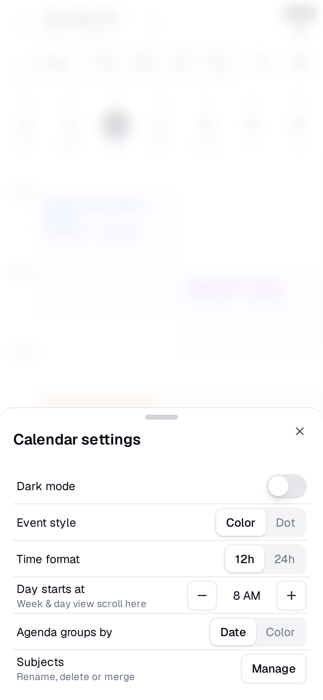

- **Dark mode:** on or off; the choice is remembered after a reload.
- **Event style:** coloured chips or a coloured dot.
- **Time format:** 12-hour or 24-hour.
- **Day starts at:** the hour Week and Day view scroll to when they open.
- **Agenda groups by:** date or colour.
- **Subjects:** opens the Subject manager.
- **Sample events:** removes the starter events (tap twice). Your own events are kept.

| Month, dark | Week, dark |
| --- | --- |
| 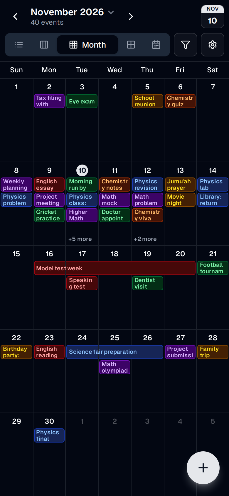 | 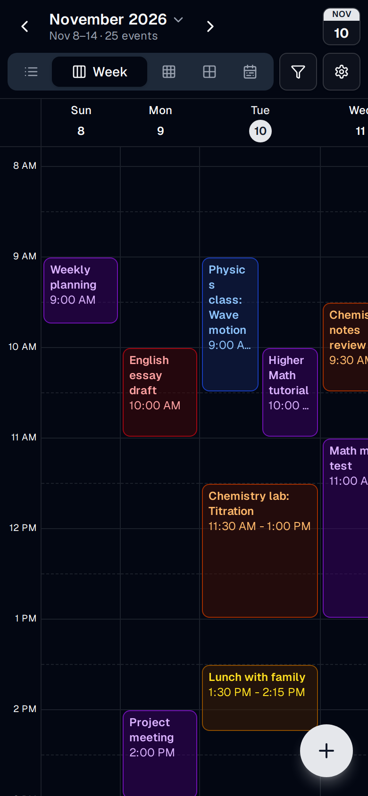 |

## 10. Where your events are saved

Events, Subjects and settings are saved in the browser's `localStorage` on your device. They stay after a reload or after closing the browser. There is no account and no server, so nothing leaves your device.

Recording: [`recordings/persist-reload.mp4`](recordings/persist-reload.mp4) (taps the 6:30 PM slot, saves "Buy new notebooks", reloads the page, and the event is still there)

Things to know:

- `localStorage` belongs to one browser on one device, and to one address. The single file opened directly, the same file on a website, and the Next.js app each keep their own separate events.
- Clearing the browser's site data deletes the events.

## 11. Use the single HTML file offline

1. Download [`release/calendar.html`](../release/calendar.html) (about 870 KB). On GitHub, open the file and use **Download raw file**.
2. Open it in Chrome, Edge, Firefox or Safari. It makes no network requests; it works with Wi-Fi off.
3. Use it like the normal app. Events are saved in that browser.

On phones, some browsers and file viewers do not keep `localStorage` for files opened from storage (`file://`). If your events disappear after closing, put the file on any static host, such as GitHub Pages or Netlify, and open it from there.

The single file contains the calendar page only, not the documentation site from the original project.

## 12. Build the single HTML file

From the project folder:

```bash
pnpm install
npm run build:single
```

This runs [`scripts/build-single.mjs`](../scripts/build-single.mjs) and writes `dist/single.html` in about two seconds:

- Tailwind builds and minifies the CSS from `globals.css`, keeping only the classes the calendar uses.
- The Geist font (woff2) is embedded in the CSS as base64.
- esbuild bundles the React app from [`single/main.tsx`](../single/main.tsx) into one minified script with all comments removed.
- Everything goes into [`single/template.html`](../single/template.html), and html-minifier-terser removes comments and whitespace.

`dist/` is not committed. The ready-made copy in [`release/calendar.html`](../release/calendar.html) is that output.

## 13. Run the project from source

```bash
git clone https://github.com/AKIBUZZAMAN-AKIB/my-calendar.git
cd my-calendar
pnpm install
pnpm dev
```

Then open `http://localhost:3000/calendar`. For a production build use `pnpm build` and `pnpm start`.

---

Made by [AKIBUZZAMAN AKIB](https://github.com/AKIBUZZAMAN-AKIB) (@AKIBUZZAMAN-AKIB). Based on [Full Calendar](https://github.com/yassir-jeraidi/full-calendar) by Jeraidi Yassir, MIT License.
